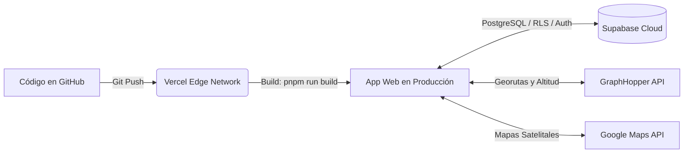

# 🚛 SIS-AGREGADOS — Sistema Integral de Control Logístico y Flotas

> **Plataforma web de última generación para la gestión, transporte y despacho de agregados de cantera (arena fina, arena gruesa, piedra chancada y afirmado), diseñada para operaciones de alta montaña en Cerro de Pasco, Perú .**

Este sistema interconecta en tiempo real a **Administradores de Flota**, **Conductores de Volquetes** y **Empresas Constructoras**, garantizando trazabilidad de pesajes en balanza, cálculo geoespacial de fletes con perfiles de altitud, reconocimiento inteligente de rutas y continuidad operativa bajo condiciones extremas y baja cobertura celular mediante una arquitectura **Offline-First** y **Clean Architecture**.

---

## 📌 Contexto de Negocio y Operación Altoandina

El transporte de materiales de construcción y áridos en la sierra central y selva central de Pasco enfrenta condiciones logísticas desafiantes:
1. **Rutas Extremas y Altura**: Pendientes pronunciadas entre los 1,800 m s.n.m. (Oxapampa) y los 4,380 m s.n.m. (Cerro de Pasco), requiriendo volquetes de tracción pesada (6x4 y 8x4) con capacidades de tolva de 15 a 20 m³.
2. **Georreferenciación de Canteras**: Despacho desde canteras estratégicas con materiales clasificados según los requerimientos estructurales de la obra.
3. **Brecha de Conectividad en Cantera**: Zonas de carga y pesaje sin cobertura celular. La plataforma implementa persistencia local en **IndexedDB**, permitiendo a los choferes registrar pesajes, tickets físicos de balanza y cambios de estado sin conexión; la sincronización se realiza automáticamente al detectar conectividad.

---

## 🗺️ Red Logística de Canteras, Destinos y Enrutamiento

### 1. Canteras Oficiales de Salida
| Cantera | Distrito / Ubicación | Altitud | Especialidad de Material |
| :--- | :--- | :--- | :--- |
| **Cantera Quiulacocha** | Cerro de Pasco | 4,380 m s.n.m. | Agregados clasificados, arena fina/gruesa, piedra chancada 1/2" y 3/4". |
| **Cantera Smelter** | Tinyahuarco | 4,100 m s.n.m. | Afirmado clasificado, base granular y roca chancada para carreteras. |
| **Cantera Río Huallaga** | Huariaca | 2,940 m s.n.m. | Agregados fluviales de río, arena lavada y confitillo para concreto. |
| **Cantera Bellavista** | Paucartambo | 2,880 m s.n.m. | Material granular, afirmado y piedra seleccionada para obras viales. |
| **Cantera Vinchos** | Pallanchacra | 3,150 m s.n.m. | Agregado chancado y piedra para cimientos y muros de contención. |

---

### 2. Cobertura de Destinos Regionales (Región Pasco y Conexiones)
El sistema cuenta con coordenadas georreferenciadas y rutas directas preconfiguradas para las tres provincias del departamento de Pasco y nodos de la sierra central:

* **Provincia de Pasco**:
  - *Yanacancha (San Juan)*, *Chaupimarca (Centro Histórico)*, *Simón Bolívar (Rancas)*.
  - *Tinyahuarco Pueblo*, *Colquijirca*, *Villa Pasco*, *Huariaca (Valle)*, *Ninacaca*, *Carhuamayo*, *Paucartambo*.
* **Provincia de Oxapampa**:
  - *Oxapampa (Capital)*, *Villa Rica*, *Pozuzo (Colonia)*, *Chontabamba*.
* **Provincia de Daniel Alcides Carrión**:
  - *Yanahuanca (Capital)*.
* **Corredores Logísticos Conectados**:
  - *Tarma (Junín)*, *Junín (Meseta de Bombón)*, *La Oroya (Yauli)*, *Huánuco Ciudad*.

---

### 3. Motor Inteligente de Geocodificación y Reconocimiento de Intención
Para garantizar que cualquier obra, proyecto o punto de entrega sea localizado al instante, el simulador implementa un buscador con **reconocimiento de lenguaje natural** y una arquitectura de fallback en 4 niveles:

1. **Normalizador de Intención Semántica (`normalizeSearchIntent`)**:
   - Limpia automáticamente prefijos conversacionales de obra (*"Obra en..."*, *"Entrega en..."*, *"Cerca a..."*, *"Sector..."*, *"Plaza de..."*), aislando la entidad geográfica central.
2. **Autocompletado en Vivo (Live Auto-suggestions)**:
   - Despliega un menú flotante con puntos de interés y direcciones detectadas en tiempo real mientras el usuario escribe (con debounce de 280 ms).
3. **Polarización Geográfica (Proximity Bias)**:
   - Sesgo geográfico centrado en la Sierra Central (`lat: -10.68, lon: -76.25`), priorizando de forma natural lugares de la región Pasco.
4. **Estrategia en Cascada Resiliente (Zero-Downtime)**:
   - **Nivel 1 (0 ms)**: Presets locales oficiales (instantáneo y sin consumo de red).
   - **Nivel 2**: Google Maps Geocoder (cuando la cuenta cuenta con facturación activa).
   - **Nivel 3 (<400 ms)**: Photon Geocoder (OSM / Komoot sin API key ni costo).
   - **Nivel 4**: OpenStreetMap Nominatim (respaldo secundario).

---

### 4. Modelo de Tarifación y Flete Logístico
El motor calcula de forma transparente la cotización según la fórmula:

$$\text{Costo Total} = \sum (\text{Volumen material} \times \text{Precio } \text{m}^3) + \text{Flete Base} + \text{Flete por Distancia}$$

* **Regla de Carga**: Los agregados no se mezclan en la misma tolva; cada material calcula sus propios viajes de volquete estándar (15 $\text{m}^3$).
* **Flete Base Operativo**: $\text{S/ } 90.00$ por viaje de volquete (incluye cargador frontal y salida de tolva en cantera).
* **Flete por Distancia**: $\text{S/ } 2.60 \text{ por km}$ recorrido por cada $10\text{ m}^3$ transportados, utilizando el kilometraje real por carretera de **GraphHopper Routing API**.

---

## 🚀 Módulos del Sistema

### 1. 🏗️ Portal de Constructoras / Clientes
* **Simulador y Calculadora de Flete Modular**:
  - Selección de cantera de origen con ficha técnica (altitud, coordenadas, descripción).
  - Cotizador multi-material dinámico: agregue múltiples tipos de agregados en una sola orden.
  - Trazado de ruta vial en **Google Maps** interactivo con marcadores y polyline real de carretera.
  - Desglose financiero transparente con opción de aplicar y generar pedido formal con un clic.
* **Flujo de Pago y Despacho Institucional**:
  - Modal con instrucciones de pago formal para el titular empresarial **SIS-AGREGADOS** (Cta. Corriente Interbank Soles).
  - Enlace automático a **WhatsApp Business** con el resumen estructurado de la orden para confirmación de pago y despacho inmediato.

### 2. 🚛 Portal Móvil del Conductor (Offline-First)
* **UI Optimizada para Cabina**: Interfaz ergonómica de alto contraste diseñada para teléfonos en campo.
* **Telemetría GPS en Vivo**: Monitoreo de precisión satelital y botón de navegación directa en Google Maps / Waze.
* **Control de Pesaje de Balanza**:
  - Registro de peso de entrada (tara) y salida (bruto) con cálculo de tonelaje neto transportado.
  - Captura fotográfica del ticket de balanza físico (con preview y almacenamiento en cola offline).
* **Certificación de Entrega en Obra**: Confirmación digital de recepción con nombre del encargado y comprobante fotográfico.

### 3. ⚙️ Consola de Control de Flotas (Administrador)
* **Monitoreo Centralizado de Despachos (`TripsList`)**:
  - Estado del volquete (*Pendiente $\rightarrow$ En Camino $\rightarrow$ En Balanza $\rightarrow$ Entregado*).
  - Control de pesajes registrados en balanza en toneladas métricas.
* **Gestión de Flota Vehicular y Catálogo Especializado (`VehiclesList` & `VehicleForm`)**:
  - Catálogo integrado de volquetes pesados para minería y construcción (*Volvo FMX, Scania XT Heavy Tipper, Mercedes-Benz Actros/Arocs, Iveco Trakker, Sinotruk HOWO, Shacman*).
  - Selección en cascada de marca/modelo con autocompletado de capacidad de tolva (15 a 20 $\text{m}^3$).
  - Validación de placa peruana MTC / SUNARP (`ABC-123`).
* **Gestión de Conductores (`DriversList` & `DriverForm`)**:
  - Validación de DNI (8 dígitos) y licencia de conducir MTC.
  - Enlace directo a WhatsApp para coordinaciones con el chofer.
  - Aprovisionamiento seguro de credenciales mediante RPC PostgreSQL (`SECURITY DEFINER`).
* **Despacho Logístico Desacoplado (`TripAssignModal` & `useTripDispatch`)**:
  - Asignación atómica de chofer y volquete libre a pedidos pendientes mediante RPC PostgreSQL `asignar_viaje`.

### 4. 🤖 Copiloto Inteligente de Operaciones (Multiagente ReAct con LLMs)
El sistema integra un copiloto conversacional autónomo para el Administrador de Flota, implementado bajo el patrón **ReAct (Reasoning + Acting)** con orquestación multiagente y memoria de traza en tiempo real:

* **Arquitectura de Agentes Especializados**:
  - **`SupervisorAgent` (Director)**: Analiza semánticamente la consulta del despachador, descompone la meta operativa y delega el flujo al subagente experto idóneo.
  - **`FleetDispatchAgent` (Logística)**: Consulta en tiempo real el inventario de volquetes, choferes en ruta, capacidades de tolva y asignaciones de pedidos.
  - **`FuelAuditAgent` (Auditoría Energética)**: Cruza el consumo reportado por los volquetes contra el modelo matemático y detecta sobreconsumos o anomalías.
* **Bucle de Razonamiento ReAct (`CopilotOrchestrator`)**:
  - Cada agente ejecuta un ciclo estructurado: $\text{Pensamiento (Thought)} \rightarrow \text{Acción (Tool)} \rightarrow \text{Observación (Observation)} \rightarrow \text{Respuesta Final}$.
  - **Registro de Trazas (`ReActTraceRecorder`)**: Permite al usuario inspeccionar en un panel visual (`CopilotTracePanel`) el razonamiento interno, qué herramientas consultó el agente y qué datos devolvió la base de datos antes de responder.
* **Caja de Herramientas Operativas (Agent Tools)**:
  - `ConsultaFlotaTool`: Inspecciona volquetes activos, modelos y choferes asignados.
  - `ConsultaPedidosTool`: Consulta cartera de pedidos en curso, destinos y materiales.
  - `CalculadoraDieselTool`: Predice el gasto de combustible diésel para rutas entre canteras y obras.
  - `ConsultaAnomaliasTool`: Filtra viajes completados que exceden el umbral de tolerancia de diésel.
* **Componentes Visuales Especializados**:
  - `AdminCopilotModal`: Consola interactiva con soporte para prompts rápidos guiados (`CopilotQuickPrompts`).
  - `CopilotAgentBadge`: Identificador dinámico con código visual de color que indica qué subagente está respondiendo.
  - `CopilotTracePanel`: Acordeón colapsable para inspección técnica paso a paso del árbol de decisión.

### 5. 🧠 Motor de Machine Learning y Telemetría de Alta Montaña
En operaciones mineras y de construcción en Cerro de Pasco (con variaciones entre 1,800 y 4,380 m s.n.m.), el consumo de combustible diésel no es lineal y depende drásticamente de la pendiente y la altitud:

* **Modelo Entrenado (`modelo_consumo_diesel.joblib`)**:
  - Modelo de Machine Learning (Random Forest Regressor) entrenado con telemetría histórica de transporte pesado en Pasco.
  - **Variables Predictivas**: Kilómetros por carretera ($\text{km}$), Desnivel acumulado positivo/negativo ($\Delta h \text{ en metros}$), Volumen de tolva ($15\text{ a }20\text{ m}^3$) y Altitud promedio de operación.
* **Persistencia de Parámetros en Base de Datos (`public.ml_parametros`)**:
  - Factores estequiométricos de corrección por altitud, factor de carga y tolerancia de desviación guardados en PostgreSQL.
* **Auditoría Automatizada de Viajes**:
  - Triggers y servicios en tiempo real (`fuelPredictionService.ts`) que contrastan el consumo reportado por el conductor al finalizar el viaje frente al consumo predicho por el modelo ML.
  - Detección inmediata de anomalías (desviaciones superiores al 15%), alertando al supervisor sobre posibles fugas, desvíos no autorizados o fallas mecánicas en ascenso.

---

## 🏛️ Arquitectura de Software y Clean Code

El sistema aplica principios estrictos de **Clean Architecture**, **SOLID** y modularización:

```txt
src/
├── shared/                                 # Capa Compartida Transversal
│   ├── components/
│   │   ├── GoogleMapView.tsx               # Visor de mapa satelital interactivo
│   │   └── ModalContainer.tsx              # Componente base accesible (role="dialog", Escape, glassmorphism)
│   ├── constants/
│   │   └── materials.ts                    # Single Source of Truth para nombres y precios de agregados
│   ├── services/                           # Servicios de Infraestructura e I/O
│   │   ├── driversService.ts               # Gestión de conductores y generación criptográfica de claves
│   │   ├── freightService.ts               # Motor de fletes, presets y geocodificación multiescalón
│   │   ├── fuelPredictionService.ts        # Inferencia de consumo diésel y telemetría de altitud
│   │   ├── graphhopperService.ts           # Cliente de enrutamiento por carretera y altimetría
│   │   ├── storageService.ts               # Subida segura de tickets (validación 5MB, MIME y extensiones)
│   │   ├── supabase.ts                     # Cliente Supabase PostgreSQL
│   │   ├── tripsService.ts                 # Operaciones de viajes, pesaje y recursos de despacho
│   │   ├── vehiclesService.ts              # CRUD de flota vehicular
│   │   └── llm/                            # Proveedores de Inteligencia Artificial
│   │       ├── geminiProvider.ts           # Conector con Google Gemini API
│   │       └── copilotRateLimiter.ts       # Rate limiter preventivo de tokens y llamadas
│   └── utils/
│       └── supabaseRelations.ts            # Mappers puros para uniones relacionales de Supabase
│
├── features/                               # Módulos por Dominio de Negocio
│   ├── admin/                              # Consola de Despacho y Copiloto IA
│   │   ├── agents/                         # Arquitectura Multiagente ReAct
│   │   │   ├── CopilotOrchestrator.ts      # Orquestador del ciclo ReAct
│   │   │   ├── SupervisorAgent.ts          # Agente de clasificación e intención
│   │   │   ├── FleetDispatchAgent.ts       # Agente especialista en flota y volquetes
│   │   │   ├── FuelAuditAgent.ts           # Agente especialista en combustible diésel
│   │   │   ├── ReActTraceRecorder.ts       # Grabador de traza de razonamiento
│   │   │   └── tools/                      # Herramientas operativas del copiloto
│   │   │       ├── CalculadoraDieselTool   # Predicción de consumo con modelo ML
│   │   │       ├── ConsultaAnomaliasTool   # Detección de sobreconsumos
│   │   │       ├── ConsultaFlotaTool       # Disponibilidad y estado de flota
│   │   │       └── ConsultaPedidosTool     # Cartera de pedidos de cantera
│   │   ├── components/                     # Interfaz de Usuario del Copiloto
│   │   │   ├── AdminCopilotModal.tsx       # Modal conversacional interactivo
│   │   │   ├── CopilotMessageList.tsx      # Historial de diálogo estructurado
│   │   │   ├── CopilotTracePanel.tsx       # Inspector de traza paso a paso
│   │   │   ├── CopilotAgentBadge.tsx       # Identificador visual del agente activo
│   │   │   └── CopilotQuickPrompts.tsx     # Preguntas rápidas y atajos operativos
│   │   └── hooks/
│   │       └── useAdminCopilot.ts          # Presenter Hook: Estado del orquestador ReAct
│   │
│   ├── auth/
│   │   └── components/
│   │       ├── LoginForm.tsx               # Acceso unificado por roles
│   │       ├── RegisterForm.tsx            # Registro público forzado a rol CLIENTE
│   │       └── ForcePasswordChangeModal    # Barrera de seguridad para cambio obligatorio en primer acceso
│   │
│   ├── pedidos/
│   │   ├── components/
│   │   │   ├── OrdersList.tsx              # Listado general de pedidos de obra
│   │   │   ├── OrderForm.tsx               # Registro de pedidos con cuenta titular SIS-AGREGADOS
│   │   │   ├── OrderDispatchDetailsModal   # Modal atómico para ver detalles del volquete y chofer
│   │   │   ├── FreightCalculatorModal.tsx  # Orquestador limpio de simulación de fletes (147 líneas)
│   │   │   └── calculator/                 # Subcomponentes Atómicos del Cotizador
│   │   │       ├── QuarrySelector.tsx      # Selector de canteras de salida
│   │   │       ├── MaterialItemsList.tsx   # Lista multi-material dinámica
│   │   │       ├── DestinationPresetList   # Buscador con autocompletado y presets regionales
│   │   │       └── QuoteBreakdownCard.tsx  # Desglose financiero y métricas viales
│   │   └── hooks/
│   │       └── useFreightCalculator.ts     # Presenter Hook: Estado y debounce reactivo
│   │
│   └── viajes/
│       ├── components/
│       │   ├── DriverTripActive.tsx        # Orquestador de panel móvil del chofer (127 líneas)
│       │   ├── TripAssignModal.tsx         # Modal declarativo de despacho sin acoplamiento a BD
│       │   ├── TripsList.tsx               # Tabla de monitoreo de viajes para el Administrador
│       │   └── driver/                     # Subcomponentes Atómicos del Chofer
│       │       ├── TripInfoCard.tsx        # Stepper y datos del flete
│       │       ├── DriverGpsPanel.tsx      # GPS en vivo y navegación externa
│       │       ├── WeighingForm.tsx        # Registro de balanza y foto de ticket
│       │       └── DeliveryConfirmation    # Certificado final de entrega en obra
│       └── hooks/
│           ├── useDriverTripActions.ts     # Presenter Hook: GPS, cámara y sincronización offline
│           └── useTripDispatch.ts          # Presenter Hook: Asignación de despacho
│
└── pages/                                  # Vistas Raíz (Landing, AdminDashboard, ClientDashboard)
```

### Estándares de Calidad:
* **Cero `@Suppress` y `@Ignore`**: Se corrige la causa raíz de cualquier aviso de linting o tipado.
* **Una clase / componente por archivo**: Alta cohesión y máxima facilidad para pruebas unitarias.
* **Separación de Lógica y Presentación**: Componentes visuales limpios alimentados por Custom Hooks (Presenters) libres de JSX.

---

## 🛡️ Seguridad Integral y Migraciones de Base de Datos

La plataforma aplica el principio de **Defensa en Profundidad** (*Defense in Depth*), garantizando que las restricciones críticas de negocio y datos residan en la base de datos (PostgreSQL / RLS) y no solo en la interfaz:

1. **Inmutabilidad de Roles y Prevención de Escalada**:
   - `handle_new_user()` asigna de forma inmutable el rol `'CLIENTE'`, ignorando cualquier payload de registro alterado desde el cliente.
   - Trigger `BEFORE UPDATE ON public.usuarios` (`proteger_columna_rol`) que rechaza cualquier intento de auto-promoción de rol por parte de usuarios no administradores.
2. **Aprovisionamiento y Cambio Obligatorio de Contraseñas**:
   - Generación de claves temporales aleatorias de alta entropía mediante `crypto.getRandomValues()` en `driversService.ts`.
   - Bandera `requiere_cambio_password` en `public.usuarios` activada en la creación del chofer.
   - Interceptor en `ProtectedRoute.tsx` que despliega `ForcePasswordChangeModal.tsx`, bloqueando el acceso operativo hasta que el usuario establezca una clave personal y segura.
3. **Hardening de Supabase Storage (`tickets-balanza`)**:
   - RLS en `storage.objects` restringido para subidas exclusivamente a `CONDUCTOR` y `ADMINISTRADOR`.
   - Validación de tipos MIME autorizados (`image/jpeg`, `image/png`, `image/webp`) y límite estricto de 5 MB por archivo.
   - Protección contra listado masivo (`public_bucket_allows_listing`): el listado de archivos está reservado a Administradores. El frontend guarda rutas internas y solicita URLs firmadas temporales al visualizar un ticket; el bucket público se mantiene activo solo durante la transición.
4. **Principio de Menor Privilegio (Least Privilege) en RPCs**:
   - Blindaje de `SET search_path = public, auth, pg_temp;` en todas las funciones con privilegios elevados (`SECURITY DEFINER`).
   - Revocación de `EXECUTE` a usuarios anónimos (`anon` y `PUBLIC`) en todas las funciones de negocio e internas de trigger.

> Para la matriz detallada de cumplimiento normativo (**CIS Controls v8**, **OWASP ASVS v4.0** e **ISO/IEC 27001**), consulte la [Política de Seguridad Formal](SECURITY.md).

---

## 🛠️ Stack Tecnológico

* **Frontend**: React 19 + Vite 8 + TypeScript (Modo Estricto).
* **Estilizado**: Tailwind CSS v4 + Lucide React Icons.
* **Inteligencia Artificial y Modelos**:
  * **Google Gemini API** (`@google/genai`): Motor de razonamiento cognitivo y comprensión semántica.
  * **Scikit-Learn & Joblib** (`modelo_consumo_diesel.joblib`): Modelo de regresión predictiva entrenado para gradientes de alta montaña.
  * **Arquitectura Multiagente ReAct**: Ciclo de razonamiento *Thought-Action-Observation* con memoria de traza en vivo.
* **Gestión de Estado**: Zustand (sesión y autenticación global).
* **Motores Geoespaciales**:
  * **Google Maps Platform** (Maps JavaScript API).
  * **GraphHopper Routing API** (perfil vial de carga pesada y perfiles altimétricos).
  * **Photon / Komoot OpenStreetMap** (geocodificación de alta velocidad con proximity bias).
* **Persistencia Offline**: IndexedDB nativo (`offlineDb.ts`) para fotos de tickets y cola transaccional.
* **Backend como Servicio (BaaS)**: Supabase (PostgreSQL 15+).
  * **Row Level Security (RLS)**: Aislamiento por roles (`ADMINISTRADOR`, `CONDUCTOR`, `CLIENTE`) y helpers `SECURITY DEFINER` antirrecursión.
  * **Stored Procedures (RPC)**: `asignar_viaje`, `iniciar_viaje`, `registrar_ticket_balanza`, `confirmar_entrega`, `admin_crear_conductor`, `marcar_password_actualizada`.
  * **Supabase Storage**: Bucket `tickets-balanza` con cuota de 5 MB y validación MIME.
* **Gestor de Paquetes**: `pnpm` v11.4+.

---

## ⚙️ Variables de Entorno

Crea tu archivo `.env.local` a partir de la plantilla:

```bash
cp .env.example .env.local
```

Configura las claves de servicio:

```env
# Supabase BaaS
VITE_SUPABASE_URL=https://tu-proyecto.supabase.co
VITE_SUPABASE_ANON_KEY=tu-anon-key

# Google Maps Platform (Mapas interactivos)
VITE_GOOGLE_MAPS_API_KEY=tu-google-maps-api-key

# GraphHopper Routing API (Cálculo de distancias viales por carretera; restringir por dominio Vercel)
VITE_GRAPHHOPPER_API_KEY=tu-graphhopper-api-key

# Google Gemini API (Copiloto Operativo de IA Multiagente)
VITE_GEMINI_API_KEY=tu-gemini-api-key
```

---

## 🚦 Ejecución en Desarrollo

```bash
# Instalar dependencias
pnpm install

# Iniciar servidor local
pnpm dev
```

### Comandos de Verificación de Calidad:
```bash
# Verificación de linting (ESLint estricto)
pnpm run lint

# Verificación de tipos TypeScript y build de producción
pnpm run build
```

### 🐳 Desarrollo local con frontend y backend en Docker

Desde esta carpeta, con `Agregados-backend` ubicado en la carpeta hermana `Desktop`:

```bash
docker compose -f docker-compose.local.yml up --build
```

La aplicación queda disponible en [http://localhost:5173](http://localhost:5173) y la API en
[http://localhost:8000/docs](http://localhost:8000/docs). Los dos servicios montan el código
local: Vite y Uvicorn recargan automáticamente los cambios sin volver a desplegar.

Para detenerlos:

```bash
docker compose -f docker-compose.local.yml down
```

El Compose local fuerza `VITE_API_BASE_URL=http://localhost:8000/api/v1`; las credenciales
del backend se leen desde `Agregados-backend/.env` y las claves públicas del frontend desde
`.env.local`.

---

## 🌐 Guía de Despliegue en Producción

Sigue esta guía paso a paso para poner en marcha la plataforma en un entorno de producción de alta disponibilidad utilizando **Supabase** (Backend/DB/Storage) y **Vercel** (Frontend/Hosting Edge).



---

### Paso 1: Configurar la Base de Datos y Seguridad en Supabase

1. **Crear Proyecto**:
   - Ingresa a [Supabase Dashboard](https://supabase.com/dashboard) y crea un nuevo proyecto (ej. `agregados-pasco-prod`).
   - Elige la región más cercana (ej. `South America (São Paulo)`).

2. **Ejecutar Migraciones SQL**:
   - Dirígete a la sección **SQL Editor** en la barra lateral.
   - Ejecuta en orden secuencial los scripts contenidos en `supabase/migrations/`:

3. **Configurar Almacenamiento (Supabase Storage)**:
   - Ve a **Storage** en la barra lateral.
   - Verifica que el bucket `tickets-balanza` exista y esté marcado como **Public bucket** (las políticas RLS aplicadas por las migraciones restringen la subida exclusivamente a choferes y administradores autorizados).
   - Configura los tipos MIME permitidos únicamente como `image/jpeg`, `image/png` y `image/webp`.
   - Mantén **Public bucket** activo hasta validar la policy `SELECT` para URLs firmadas y completar las pruebas de descarga. Después podrá desactivarse sin cambiar el frontend.

4. **Configurar Autenticación (Auth)**:
   - Ve a **Authentication** > **URL Configuration**:
     - **Site URL**: `https://tu-proyecto.vercel.app` (o tu dominio personalizado).
     - **Redirect URLs**: Añadir las URLs autorizadas para redirección:
       ```txt
       https://tu-proyecto.vercel.app/**
       http://localhost:5173/**
       ```
   - **Confirmación de Correo**:
     - En **Authentication** > **Providers** > **Email**:
       - Si deseas que los usuarios verifiquen su bandeja de entrada antes de ingresar, mantén **Confirm email** activado.
       - Si prefieres acceso inmediato tras el registro (común en fases de prueba y MVP), desmarca **Confirm email**.

---

### Paso 2: Despliegue del Frontend en Vercel

El proyecto incluye un archivo [`vercel.json`](file:///c:/Users/paolo/Desktop/Agregados/vercel.json) preconfigurado con las reglas de rewrite necesarias para que el enrutamiento SPA (React Router) funcione sin arrojar errores `404 Not Found` al refrescar rutas como `/login`, `/admin` o `/cliente`.

#### Opción A: Despliegue Continuo con GitHub (Recomendado)
1. Sube tu repositorio a GitHub.
2. Ingresa a [Vercel Dashboard](https://vercel.com/dashboard) y haz clic en **"Add New Project"**.
3. Importa el repositorio `agregados-pasco-mvp`.
4. En **Project Settings**, confirma los siguientes parámetros:
   - **Framework Preset**: `Vite`
   - **Build Command**: `pnpm run build`
   - **Output Directory**: `dist`
   - **Install Command**: `pnpm install`

#### Opción B: Despliegue mediante Vercel CLI
```bash
# Instalar CLI si no la tienes
pnpm dlx vercel login

# Vincular y desplegar a producción
pnpm dlx vercel --prod
```

---

### Paso 3: Configuración de Variables de Entorno en Producción

En el panel de tu proyecto en Vercel, navega a **Settings** > **Environment Variables** y añade las siguientes claves obligatorias:

| Variable | Descripción | Ejemplo / Fuente |
| :--- | :--- | :--- |
| `VITE_SUPABASE_URL` | URL de tu API REST de Supabase |
| `VITE_SUPABASE_ANON_KEY` | Clave pública anónima de Supabase |
| `VITE_GOOGLE_MAPS_API_KEY` | API Key de Google Maps Platform con Maps JS API |
| `VITE_GRAPHHOPPER_API_KEY` | Clave de API de GraphHopper para enrutamiento vial |

> [!IMPORTANT]
> Tras registrar o actualizar variables de entorno en Vercel, es indispensable realizar un nuevo despliegue (**Redeploy**) para que los valores se inyecten durante la fase de compilación del bundle de Vite.

---

### Paso 4: Pruebas de Humo Post-Despliegue (Smoke Testing)

Una vez completado el despliegue, realiza la siguiente lista de verificación:

- [ ] **Acceso y Renderizado**: Carga la URL de producción y verifica que la landing page cargue correctamente con el diseño temático de alta montaña.
- [ ] **SPA Routing**: Accede directamente por URL a `https://tu-dominio.vercel.app/login` y `https://tu-dominio.vercel.app/register` comprobando que no devuelvan error 404.
- [ ] **Simulador de Fletes**: Selecciona una cantera y un destino; verifica que Google Maps trace la ruta y GraphHopper calcule la distancia y altimetría.
- [ ] **Registro e Inicio de Sesión**: Crea un nuevo cliente y valida el ingreso correcto al portal de cliente.
- [ ] **Consola de Control**: Inicia sesión con credenciales de Administrador y verifica la carga de vehículos, choferes y despachos.

